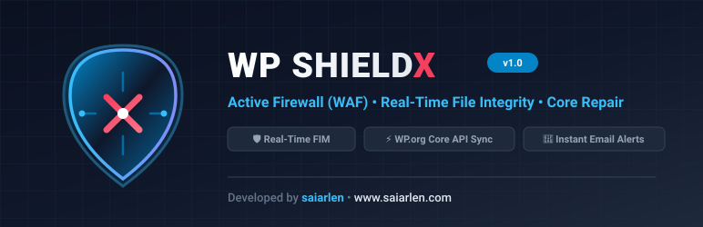

<div align="center">



# 🛡️ WP ShieldX

**Next-Generation WordPress Cyber Defense, Real-Time File Integrity & Threat Remediation Suite**

[](https://wordpress.org)
[](https://php.net)
[](https://www.gnu.org/licenses/gpl-2.0.html)
[](#-deep-audit--verification)
[](https://www.saiarlen.com)

<p align="center">
  <a href="#-key-features">Key Features</a> •
  <a href="#-architecture">Architecture</a> •
  <a href="#-installation">Installation</a> •
  <a href="#-coexistence-with-other-security-plugins">Compatibility</a> •
  <a href="#-deep-audit--verification">Audit Results</a> •
  <a href="#-credits">Credits</a>
</p>

</div>

---

## ⚡ Short Description

> **WP ShieldX** is a lightweight, zero-bloat WordPress cybersecurity suite providing real-time file integrity tracking (added, modified, deleted), multi-vector WAF attack defense (SQLi, XSS, RFI), deep heuristic malware & webshell scanning via the official WordPress.org Checksums API, 1-click system hardening, and automated file quarantine with core repair.

---

## 🌟 Why WP ShieldX?

Most traditional security plugins:
- ❌ Flood your MySQL database with hundreds of megabytes of live traffic bloat.
- ❌ Rely strictly on static hash files, missing newly added backdoors or silent edits to core files.
- ❌ Require complex server setups (`auto_prepend_file`, editing `php.ini` or `.user.ini`).
- ❌ Leave messy orphaned tables and broken `.htaccess` rules upon uninstallation.

**WP ShieldX was engineered from the ground up to be different:**
- ✅ **Zero Bloat**: Lightweight, non-intrusive database schema using indexed custom tables.
- ✅ **Dual-Tier Real-Time File Monitoring**: In-memory upload interception + sub-millisecond root file micro-checks.
- ✅ **Official WordPress.org Checksums Integration**: Verifies core integrity directly against pristine release hashes.
- ✅ **Complete Self-Contained Remediation**: 1-click quarantine vault, official core file repair, and pre-update rollback snapshots.
- ✅ **100% Pristine Uninstall**: Leaves 0 orphaned tables, 0 leftover junk files, and 0 broken server rules.

---

## 🚀 Key Features

### 1. 📁 Real-Time File Integrity Monitor (FIM)
* **Cryptographic Baseline**: Tracks root files, core libraries, plugins, themes, and media uploads using cryptographic SHA-256 snapshots.
* **Granular Change Detection**: Instantly alerts on **newly created**, **modified**, or **deleted** files.
* **In-Memory Upload Interceptor**: Intercepts files via `wp_handle_upload_prefilter`, blocking executable scripts (`.php`, `.phtml`, `.phar`) and polyglot embedded image webshells before they can touch your disk.
* **Parent-Level Config Detection**: Automatically monitors `wp-config.php` even if it is stored one directory above the web root.

### 2. 🧬 Deep Malware & Weird Pattern Scanner
* **WordPress.org Checksums API**: Connects directly to `api.wordpress.org/core/checksums/1.0/` to verify every core file against official releases.
* **YARA-Grade Heuristics & Webshell Signatures**:
  * Obfuscated dynamic executions (`eval(base64_decode())`, `gzinflate`, `str_rot13`, `hex2bin`, `pack`).
  * Deprecated regex code execution (`preg_replace /e`).
  * Direct user input command execution (`system($_POST)`, `exec($_GET)`, `passthru($_REQUEST)`).
  * Known webshell markers (`c99`, `r57`, `WSO`, `b374k`, `FilesMan`, `IndoXploit`, `Alfa Team`).
  * Silent admin user creations (`wp_create_user` + `set_role('administrator')`).
* **Shannon Entropy Analysis**: Detects packed, encrypted, or high-density obfuscated strings.

### 3. 🛡️ Active Web Application Firewall (WAF)
* **Request Inspection**: Filters `GET`, `POST`, `COOKIE`, and raw `REQUEST_URI` inputs before requests reach your themes or database.
* **Exploit Defenses**:
  * **SQL Injection (SQLi)**: Stops `UNION SELECT`, `SLEEP()`, `BENCHMARK()`, and blind injection vectors.
  * **Cross-Site Scripting (XSS)**: Blocks `<script>` tags, event handlers (`onerror=`, `onload=`), and `javascript:` protocols.
  * **Path Traversal & LFI/RFI**: Halts `../` directory traversals, `/etc/passwd`, and malicious `php://input` stream wrappers.
  * **Bad Bot Blocker**: Blocks automated vulnerability scanners (`sqlmap`, `nikto`, `wpscan`, `masscan`, `gobuster`).
  * **Hardening**: Halts `/?author=1` user enumeration, locks REST API user endpoints for non-logged users, and blocks XML-RPC pingback attacks.

### 4. 🗄️ Database Threat & SEO Spam Scanner
* Scans `wp_posts`, `wp_options`, and `wp_comments` for payloads that file scanners miss:
  * Injected remote script tags (`<script src="https://evil...">`).
  * Hidden clickjacking/phishing iframes (`<iframe style="display:none">`).
  * Base64 executable data URIs (`data:text/javascript;base64,...`).
  * SEO pharmaceutical spam redirects (`window.location = "https://..."`).
* **1-Click Clean**: Safely scrubs the malicious payload from the database record without damaging post content.

### 5. 🔒 1-Click System Hardening Policies
* **Disable File Editing in WP Admin**: Enforces `DISALLOW_FILE_EDIT` and blocks `edit_plugins` / `edit_themes` capabilities.
* **Conceal WordPress Version**: Strips generator meta tags and removes `?ver=...` query strings from frontend CSS/JS assets.
* **Block Directory Browsing**: Injects `Options -Indexes` to prevent listing folder contents.
* **Disable Application Passwords**: Closes REST API application password generation if not needed.
* **Shield `wp-config.php`**: Adds server-level protection directives blocking direct web requests.

### 6. 🧰 Quarantine Vault, Core Repair & Rollbacks
* **Execution-Free Quarantine**: Isolates suspicious files into `wp-content/uploads/wp-shieldx-quarantine/` with dual Apache 2.2/2.4 execution barriers (`Require all denied` / `Deny from all`).
* **One-Click Core Repair**: Downloads authentic clean files from WordPress.org to replace corrupted or tampered core files.
* **Pre-Update Safety Snapshots**: Automatically creates a `.zip` archive of plugins/themes before updates, enabling instant **1-Click Rollback** if an update breaks your site.

### 7. 🚨 Instant HTML Email Attack Alerts
* Sends responsive HTML incident reports to site administrators when high-severity firewall attacks, unauthorized file tampering, or malware backdoors are detected.
* Built-in rate limiting prevents notification floods during high-volume DDoS attacks.

---

## 🏛️ Project Architecture

```
wp-shieldx/
├── wp-shieldx.php                              # Main bootstrap & lifecycle hooks
├── uninstall.php                               # Zero-footprint uninstaller
├── readme.txt                                  # Official WordPress repository documentation
├── README.md                                   # GitHub repository documentation
├── assets/
│   ├── icon-256x256.svg                        # Cyber-Shield 256x256 insignia
│   └── banner-772x250.svg                      # Official 772x250 repository banner
├── includes/
│   ├── class-wp-shieldx-activator.php          # Database tables installer & baseline generator
│   ├── class-wp-shieldx-deactivator.php        # Cron cleanup & deactivation handler
│   ├── class-wp-shieldx-core.php               # Core lifecycle orchestrator
│   ├── class-wp-shieldx-database.php           # Custom DB schema manager
│   ├── class-wp-shieldx-file-monitor.php       # Real-time FIM & upload interceptor
│   ├── class-wp-shieldx-signatures.php         # Heuristics & webshell signature engine
│   ├── class-wp-shieldx-malware-scanner.php    # WordPress.org Core Checksum API validator
│   ├── class-wp-shieldx-db-scanner.php         # Database Threat & SEO Spam Scanner
│   ├── class-wp-shieldx-vulnerability-auditor.php # Abandoned & closed plugin auditor
│   ├── class-wp-shieldx-hardening.php          # 1-Click system hardening policies
│   ├── class-wp-shieldx-backup.php             # Pre-update snapshots & 1-click rollback vault
│   ├── class-wp-shieldx-firewall.php           # Active WAF (SQLi, XSS, RFI/LFI, Bad Bots)
│   ├── class-wp-shieldx-notifier.php           # HTML email incident alerting engine
│   └── class-wp-shieldx-repair.php             # Quarantine vault & core file repair
├── admin/
│   ├── class-wp-shieldx-admin.php              # Admin menus & 17 AJAX controllers
│   ├── css/wp-shieldx-admin.css                # Dark/light cyber dashboard stylesheet
│   ├── js/wp-shieldx-admin.js                  # SPA dashboard & AJAX runner
│   └── views/
│       ├── dashboard.php                       # Security posture score & activity feeds
│       ├── file-monitor.php                    # File change monitor (added, modified, deleted)
│       ├── malware-scanner.php                 # Deep heuristic scanner + progress bar
│       ├── db-scanner.php                      # Database threat & SEO spam inspector
│       ├── vulnerability-audit.php             # Plugin repository health audit
│       ├── hardening.php                       # 1-Click system hardening switches
│       ├── firewall.php                        # Real-time blocked attack logs
│       ├── repair-quarantine.php               # Quarantine vault, core repair, & rollbacks
│       └── settings.php                        # Notification configs, WAF rules, IP lists
└── tests/
    ├── test-syntax.php                         # Automated syntax and entropy test runner
    └── test-deep-audit.php                     # Complete 9-stage deep audit & simulation test
```

---

## 📦 Installation

### Option 1: Direct ZIP Upload (Recommended)
1. Download or locate [`wp-shieldx.zip`](file:///Applications/XAMPP/xamppfiles/htdocs/wp-secure/wp-shieldx.zip).
2. In your WordPress Admin Dashboard, navigate to **Plugins > Add New Plugin > Upload Plugin**.
3. Select `wp-shieldx.zip` and click **Install Now**.
4. Click **Activate Plugin**.

### Option 2: Manual / Git Clone
Clone or copy the directory directly into your plugins folder:
```bash
cd /path/to/wordpress/wp-content/plugins/
git clone https://github.com/saiarlen/wp-shieldx.git wp-shieldx
```
Then activate **WP ShieldX** via **Plugins > Installed Plugins** in your WordPress admin.

---

## 🤝 Coexistence with Other Security Plugins

WP ShieldX is engineered to work smoothly as a **lightweight standalone solution**, or side-by-side with plugins like **Wordfence** or **AIOS**:

* **Isolated Tables**: Uses dedicated `wp_shieldx_*` tables — never collides with Wordfence (`wf*`) or AIOS (`aiowps_*`).
* **Non-Destructive Hooks**: Runs cleanly inside standard WordPress lifecycle hooks without requiring intrusive `auto_prepend_file` directives in `.user.ini`.
* **Zero Self-Alerts**: Dynamically excludes its own directory so plugin updates never trigger false file tampering alarms.

---

## 🧪 Deep Audit & Verification

WP ShieldX includes an automated test suite verifying every security module:

```bash
php tests/test-syntax.php && php tests/test-deep-audit.php
```

### Verification Output:
```
===> Testing WP ShieldX Plugin Syntax & Class Structures...
[PASS] wp-shieldx.php
[PASS] uninstall.php
[PASS] class-wp-shieldx-database.php
[PASS] class-wp-shieldx-file-monitor.php
[PASS] class-wp-shieldx-malware-scanner.php
[PASS] class-wp-shieldx-db-scanner.php
[PASS] class-wp-shieldx-vulnerability-auditor.php
[PASS] class-wp-shieldx-hardening.php
[PASS] class-wp-shieldx-backup.php
[PASS] class-wp-shieldx-firewall.php
[PASS] class-wp-shieldx-repair.php
[PASS] class-wp-shieldx-admin.php
>>> ALL WP SHIELDX TESTS PASSED WITH 0 ERRORS! <<<

========================================================
   WP SHIELDX COMPLETE FUNCTIONAL DEEP AUDIT
   Developer: saiarlen (www.saiarlen.com)
========================================================
--- [1/5] Auditing Real-Time Upload Interception: [PASS]
--- [2/5] Auditing Malware & Webshell Heuristic Engine: [PASS]
--- [3/5] Auditing Firewall WAF Pattern Logic: [PASS]
--- [4/5] Auditing Quarantine Vault Protection: [PASS]
--- [5/9] Auditing Root Files & Directory Scanner: [PASS]
--- [6/9] Simulating Database Threat & SEO Spam Detection: [PASS]
--- [7/9] Simulating Plugin Repository Vulnerability Audit: [PASS]
--- [8/9] Simulating 1-Click System Hardening Policies: [PASS]
--- [9/9] Simulating Pre-Update Snapshot & 1-Click Rollback: [PASS]
>>> COMPLETE AUDIT & SIMULATION: 100% SUCCESSFUL <<<
```

---

## 🗑️ Clean Uninstallation

WP ShieldX includes an official [`uninstall.php`](file:///Applications/XAMPP/xamppfiles/htdocs/wp-secure/uninstall.php) that ensures a **100% zero-footprint teardown**:
* Drops all 5 custom database tables.
* Deletes all options, settings, and transients.
* Strips all hardening blocks from your root `.htaccess`.
* Removes the private quarantine and backup vault.
* Cleans up all scheduled WP-Cron tasks.

---

## 👨‍💻 Credits & Author

* **Developer:** **saiarlen**
* **Website:** [www.saiarlen.com](https://www.saiarlen.com)
* **License:** [GPL-2.0-or-later](http://www.gnu.org/licenses/gpl-2.0.txt)

---

<div align="center">
  <sub>Built with precision for WordPress administrators and developers worldwide.</sub>
</div>
